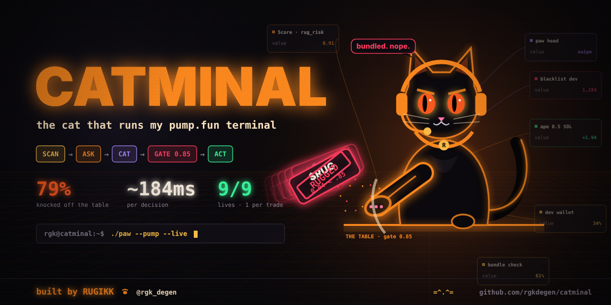
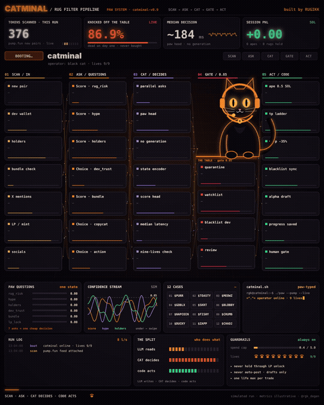
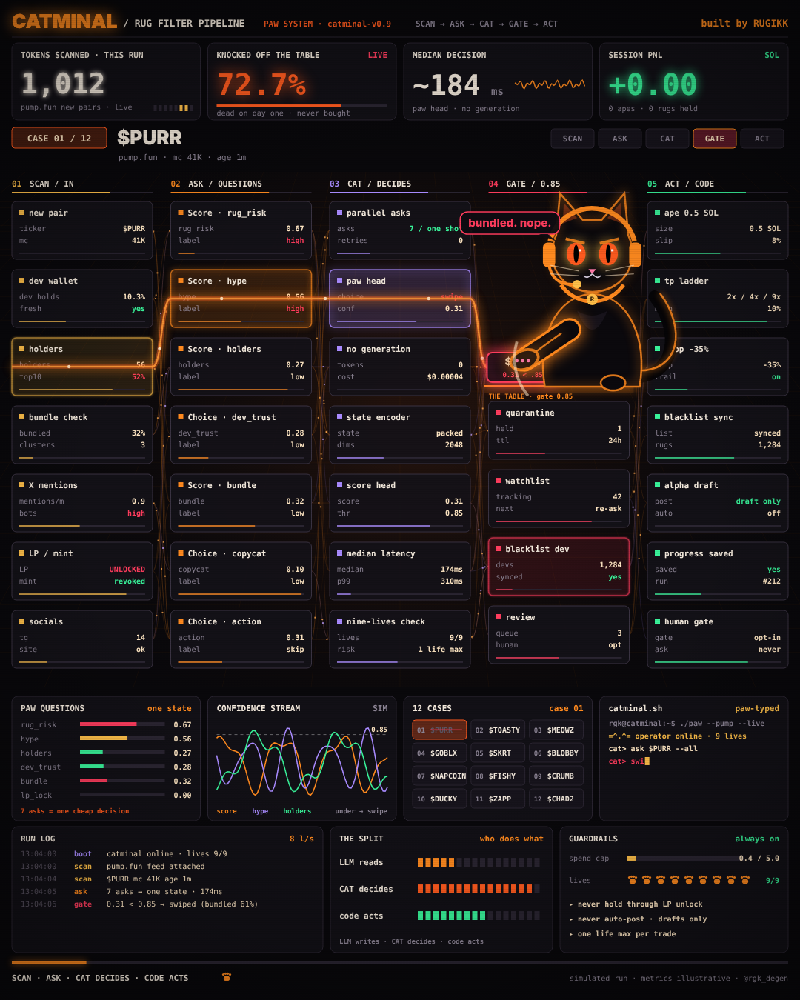
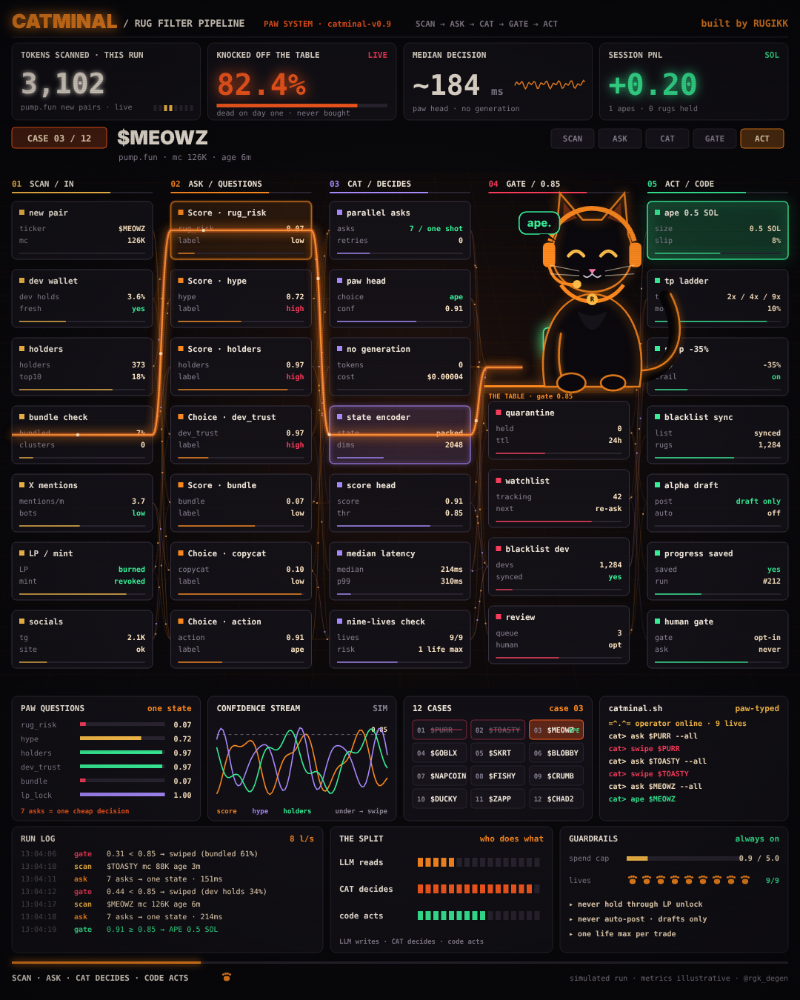
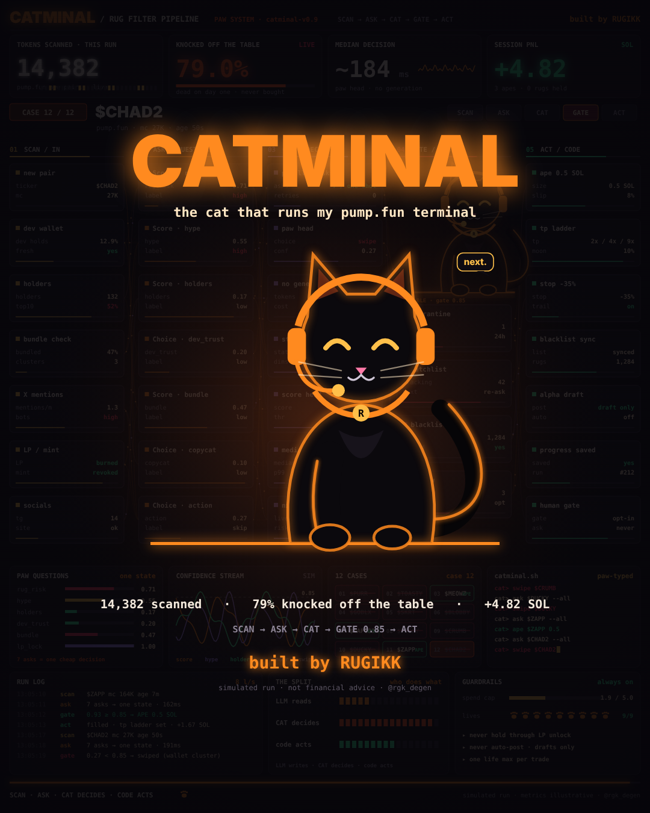

<div align="center">



# CATMINAL

**The cat that runs my pump.fun terminal.**

`SCAN → ASK → CAT → GATE 0.85 → ACT`



*79% of pump.fun tokens die on day one. The cat knocks them off the table before you can ape.*

</div>

---

## What it is

CATMINAL is an animated rug-filter terminal with a black cat in an orange headset as the operator.
Every new pump.fun pair runs through a five-column pipeline. The cat makes the call at the gate:

| Column | Job |
| --- | --- |
| **01 SCAN / IN** | new pair, dev wallet, holders, bundle %, X mentions, LP / mint, socials |
| **02 ASK / QUESTIONS** | 7 typed asks against one state: `rug_risk`, `hype`, `holders`, `dev_trust`, `bundle`, `copycat`, `action` (one shot, no retries) |
| **03 CAT / DECIDES** | paw head scores the state. No generation, ~184 ms |
| **04 GATE / 0.85** | under 0.85 → the cat swipes the token off the table. Over 0.85 → it passes |
| **05 ACT / CODE** | deterministic actions: 0.5 SOL entry, TP ladder 2x / 4x / 9x, stop −35%, dev blacklist sync, alpha draft (never auto-posted) |

Around the pipeline: KPI strip (tokens scanned, % knocked off, median decision, session PnL), paw-question bars,
confidence stream, the 12-case grid, a paw-typed `catminal.sh` shell, a run log, *The Split* (LLM reads · CAT decides · code acts)
and guardrails (spend cap, **9 lives**, one life max per trade).

<p align="center">
  
  
  
</p>

Full clip with sound: [`assets/catminal.mp4`](assets/catminal.mp4)

## Run it

It's one self-contained HTML file: canvas only, no build step, no dependencies.

```bash
git clone https://github.com/rgkdegen/catminal.git
cd catminal
open index.html          # macOS. Or just double-click it. Loops forever.
```

## Render the video yourself

Frame-exact, deterministic render: 30 s · 1080×1350 (4:5) · 30 fps, with a synthesized soundtrack.

```bash
pip install -r requirements.txt
python -m playwright install chromium
# ffmpeg must be on PATH

python scripts/render.py video            # -> out/catminal.mp4
python scripts/render.py stills 2.9 7.3   # -> out/still_02.90.png, out/still_07.30.png
python scripts/render.py banner           # -> assets/banner.png (1280x640)
```

`index.html` exposes `renderAt(t)` and `frameData(t)` on `window`, so you can grab any moment of the timeline.

## Make it yours

Everything lives at the top of `index.html`:

- **`C`** holds the palette (graphite / neon orange / amber, red for rugs, green for apes)
- **`CASES`** holds the 12 tokens: ticker, mc, age, the reason it gets swiped, score, pass/fail, the cat's one-liner, PnL
- **`COLS`** holds the column names and card labels
- `drawCat()` draws the mascot (headset, collar tag, swipe arm, moods `n` / `squint` / `mad`)

## Disclaimer

This is a **visual simulation**. Tokens, scores and PnL are illustrative. The "79% die on day one" figure comes from
Bitquery's pump.fun survival data (Oct 2026). It does not trade, connect to a wallet, or touch the chain. Not financial advice.

---

<div align="center">

**built by RUGIKK** · [@rgk_degen](https://x.com/rgk_degen) · MIT

`=^.^=`

</div>
